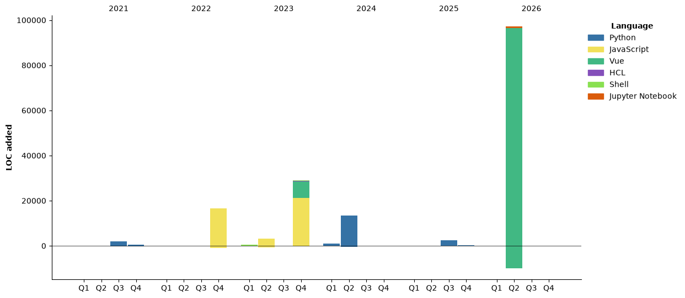

<!-- markdownlint-disable MD033 -->
<div align="center">

# Olá, eu sou o Reinaldo 👋

**Redes de Computadores • Sistemas de Telecomunicações • Python, Backend & DevOps**

<p>
  <a href="https://www.linkedin.com/in/jreinaldosilva" target="_blank">
    
  </a>
  <a href="https://www.instagram.com/penguin.bash_" target="_blank">
    
  </a>
</p>

</div>

---

## 👨‍💻 Sobre mim

Sou graduado em **Tecnologia em Redes de Computadores** pelo **IFPB** (2023) e atualmente curso **Sistemas de Telecomunicações**. Tenho foco em desenvolvimento **Backend**, **Automação** e **DevOps**, conectando infraestrutura de redes e Linux à construção de APIs e aplicações práticas.

- 🎓 **Formação:** Tecnologia em Redes de Computadores (IFPB, 2023) • Cursando Sistemas de Telecomunicações
- 🚀 **Foco atual:** Python, FastAPI, Automação e Docker
- 🤝 **Aberto a colaborações:** Projetos de Backend e DevOps
- 💬 **Assuntos favoritos:** Python, Redes de Computadores e Linux

---

## 🛠️ Tecnologias & Ferramentas

| Categoria | Stack |
| :--- | :--- |
| **Linguagens** | [](https://www.python.org/) [](https://developer.mozilla.org/docs/Web/JavaScript) [](https://www.gnu.org/software/bash/) |
| **Frameworks & Bibliotecas** | [](https://fastapi.tiangolo.com/) [](https://flask.palletsprojects.com/) [](https://nodejs.org/) [](https://expressjs.com/) [](https://vuetifyjs.com/) [](https://getbootstrap.com/) [](https://www.prisma.io/) |
| **DevOps, Dados & Tools** | [](https://www.docker.com/) [](https://git-scm.com/) [](https://www.postgresql.org/) [](https://www.sqlalchemy.org/) [](https://code.visualstudio.com/) [](https://www.android.com/) |
| **Sistemas Operacionais** | [](https://ubuntu.com/) [](https://fedoraproject.org/) [](https://linuxmint.com/) [](https://www.opensuse.org/) [](https://www.microsoft.com/windows) |

---

## 📊 Métricas de Desenvolvimento

<!--START_SECTION:waka-->


**🐱 My GitHub Data** 

> 📦 11.9 kB Used in GitHub's Storage 
 > 
> 🏆 20 Contributions in the Year 2026
 > 
> 💼 Opted to Hire
 > 
> 📜 22 Public Repositories 
 > 
> 🔑 1 Private Repositories 
 > 
**I'm an Early 🐤** 

```text
🌞 Morning                31 commits          ███░░░░░░░░░░░░░░░░░░░░░░   12.45 % 
🌆 Daytime                100 commits         ██████████░░░░░░░░░░░░░░░   40.16 % 
🌃 Evening                97 commits          ██████████░░░░░░░░░░░░░░░   38.96 % 
🌙 Night                  21 commits          ██░░░░░░░░░░░░░░░░░░░░░░░   08.43 % 
```
📅 **I'm Most Productive on Wednesday** 

```text
Monday                   34 commits          ███░░░░░░░░░░░░░░░░░░░░░░   13.65 % 
Tuesday                  28 commits          ███░░░░░░░░░░░░░░░░░░░░░░   11.24 % 
Wednesday                54 commits          █████░░░░░░░░░░░░░░░░░░░░   21.69 % 
Thursday                 49 commits          █████░░░░░░░░░░░░░░░░░░░░   19.68 % 
Friday                   14 commits          █░░░░░░░░░░░░░░░░░░░░░░░░   05.62 % 
Saturday                 34 commits          ███░░░░░░░░░░░░░░░░░░░░░░   13.65 % 
Sunday                   36 commits          ████░░░░░░░░░░░░░░░░░░░░░   14.46 % 
```


📊 **This Week I Spent My Time On** 

```text
🕑︎ Time Zone: America/Recife

💬 Programming Languages: 
Other                    8 hrs 38 mins       █████████████░░░░░░░░░░░░   51.33 % 
TypeScript               3 hrs 8 mins        █████░░░░░░░░░░░░░░░░░░░░   18.65 % 
JSON                     2 hrs 35 mins       ████░░░░░░░░░░░░░░░░░░░░░   15.38 % 
Markdown                 1 hr 34 mins        ██░░░░░░░░░░░░░░░░░░░░░░░   09.36 % 
JavaScript               28 mins             █░░░░░░░░░░░░░░░░░░░░░░░░   02.85 % 

🔥 Editors: 
Antigravity CLI          6 hrs 21 mins       █████████░░░░░░░░░░░░░░░░   37.80 % 
Antigravity Desktop      5 hrs 38 mins       ████████░░░░░░░░░░░░░░░░░   33.53 % 
VS Code                  2 hrs 57 mins       ████░░░░░░░░░░░░░░░░░░░░░   17.60 % 
Copilot CLI              1 hr 43 mins        ███░░░░░░░░░░░░░░░░░░░░░░   10.20 % 
Copilot                  8 mins              ░░░░░░░░░░░░░░░░░░░░░░░░░   00.86 % 

🐱‍💻 Projects: 
micro-erp                8 hrs 18 mins       ████████████░░░░░░░░░░░░░   49.39 % 
Downloads                6 hrs 4 mins        █████████░░░░░░░░░░░░░░░░   36.12 % 
Unknown Project          2 hrs 11 mins       ███░░░░░░░░░░░░░░░░░░░░░░   12.99 % 
joser                    13 mins             ░░░░░░░░░░░░░░░░░░░░░░░░░   01.37 % 
Área de Trabalho         1 min               ░░░░░░░░░░░░░░░░░░░░░░░░░   00.13 % 

💻 Operating System: 
Windows                  16 hrs 50 mins      █████████████████████████   100.00 % 
```

🤖 **AI Coding This Week** 

```text
⏱ AI Coding Time: 16 hrs 14 mins (96.44%)

✍️ 186 lines written by AI, 59 lines written by hand (75.92% AI-written)

🔤 2,305,796 Input Tokens, 189,961 Output Tokens

💵 $9.26 Estimated AI Cost This Week

🧠 11 AI Sessions, 196 AI Prompts

GPT                      156 lines           ████████████████████░░░░░   81.25 % 
Code                     36 lines            █████░░░░░░░░░░░░░░░░░░░░   18.75 % 
Gemini                   0 lines             ░░░░░░░░░░░░░░░░░░░░░░░░░   00.00 % 
Opus                     0 lines             ░░░░░░░░░░░░░░░░░░░░░░░░░   00.00 % 

🔎 AI Coding Insights:
🤖 AI-Driven — 75.92% of written lines came from AI
📄 Detailed Prompter — average 526 characters per prompt
🔁 Iterative Prompter — average 18 prompts per session
🚀 High AI Trust — 27.0% of changed lines were hand-edited
```

**I Mostly Code in Python** 

```text
Python                   7 repos             ██████████░░░░░░░░░░░░░░░   41.18 % 
Shell                    3 repos             ████░░░░░░░░░░░░░░░░░░░░░   17.65 % 
JavaScript               3 repos             ████░░░░░░░░░░░░░░░░░░░░░   17.65 % 
Vue                      2 repos             ███░░░░░░░░░░░░░░░░░░░░░░   11.76 % 
Jupyter Notebook         1 repo              █░░░░░░░░░░░░░░░░░░░░░░░░   05.88 % 
```


**Timeline**




 Last Updated on 25/11/2026 18:59:38 UTC
<!--END_SECTION:waka-->
